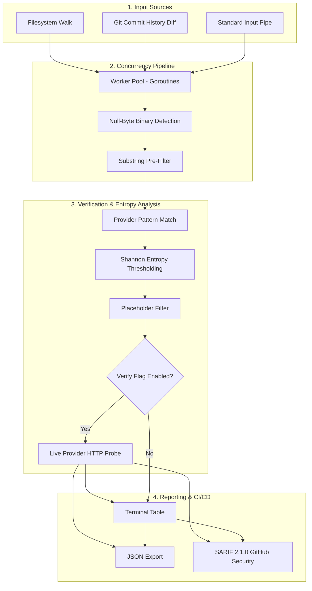

# Spectral

> High-performance secret scanner and API key detector in Go.

[](https://github.com/ispectr3/spectral/actions/workflows/ci.yml)
[](https://go.dev)
[](LICENSE)
[](https://docs.github.com/en/code-security/code-scanning)

Spectral is a concurrent secret scanner written in Go designed for static application security testing (SAST), pre-commit auditing, and secret leakage detection across filesystems and Git histories.

It pairs signature-based pattern matching with Shannon entropy thresholding to reduce false positives from documentation and test placeholders, and provides an optional live verification engine to validate credential liveness against provider endpoints.

---

## Architecture



---

## Core Characteristics

- **Concurrent Processing:** Worker pool built on Go goroutines for parallel directory traversal and file inspection.
- **Unique Segment Matching:** Targets immutable key structures (such as Base64 markers `T3BlbkFJ` in modern OpenAI keys and versioned prefixes in Anthropic keys) to eliminate false detections in documentation and tutorial samples.
- **Shannon Entropy Analysis:** Computes character frequency entropy $H(X) = -\sum P(x_i) \log_2 P(x_i)$ to discard low-entropy and placeholder strings.
- **Git History Auditing:** Traverses commit diffs (`git log -p`) to identify secrets that were committed and subsequently removed from active branches.
- **Liveness Probing:** Optional non-destructive HTTP checks against provider APIs (OpenAI, Anthropic, Stripe, GitHub, HuggingFace) to categorize credentials as active, revoked, or rate-limited.
- **SARIF 2.1.0 Support:** Formatted output for integration with GitHub Code Scanning alerts.
- **Zero External Dependencies:** Built entirely with the Go standard library, compiling to a standalone static binary without CGO requirements.

---

## Supported Providers

| Provider | Signature Pattern / Mechanism | Target Scope | Live Verification |
| :--- | :--- | :--- | :--- |
| OpenAI (Project) | `sk-proj-[A-Za-z0-9_-]{8,}T3BlbkFJ...` | LLM API Keys | Supported |
| OpenAI (Legacy) | `sk-[A-Za-z0-9]{48}` | User API Keys | Supported |
| Anthropic | `sk-ant-api03-[A-Za-z0-9_-]{80,110}` | Claude Endpoints | Supported |
| AWS IAM | `(AKIA\|AGPA\|AIDA\|AROA\|AIPA)[A-Z0-9]{16}` | Cloud Infrastructure | Supported |
| Stripe | `sk_live_[0-9a-zA-Z]{24,99}` | Payment Gateways | Supported |
| GitHub | `ghp_[0-9a-zA-Z]{36}`, `github_pat_...` | Repository & CI Tokens | Supported |
| HuggingFace | `hf_[0-9a-zA-Z]{34}` | Model Repositories | Supported |
| Google Gemini | `AIzaSy[A-Za-z0-9_-]{33}` | AI Platform Keys | Supported |
| Slack | `xoxb-[0-9]{10,13}-[0-9]{10,13}-...` | Bot Tokens | Supported |
| Groq Cloud | `gsk_[a-zA-Z0-9]{52}` | Inference APIs | None |
| Pinecone | `pcsk_[a-zA-Z0-9_-]{48,70}` | Vector Database | None |
| SendGrid | `SG\.[0-9a-zA-Z_-]{22}\.[0-9a-zA-Z_-]{43}` | Email Infrastructure | None |
| Resend | `re_[a-zA-Z0-9]{32,48}` | Transactional Email | None |
| Discord | `[MN][A-Za-z0-9]{23,25}\...` | Bot Credentials | None |
| Telegram | `[0-9]{9,10}:[a-zA-Z0-9_-]{35}` | Bot Credentials | None |
| Postman | `PMAK-[a-f0-9]{24}-[a-f0-9]{34}` | Workspace Integrations | None |

---

## Installation

### From Source
```bash
git clone https://github.com/ispectr3/spectral.git
cd spectral
go build -o spectral ./cmd/spectral
```

### Via `go install`
```bash
go install github.com/ispectr3/spectral/cmd/spectral@latest
```

---

## Usage

### Local Filesystem Scan
```bash
# Scan working directory with default thread pool (16 workers)
./spectral -path .

# Scan specific directory with 32 worker threads
./spectral -path /path/to/project -threads 32
```

### Live Credential Verification
```bash
# Verify detected secrets against upstream provider APIs
./spectral -path . -verify

# Filter output to display only confirmed active credentials
./spectral -path . -verified-only
```

### Git History Scan
```bash
# Inspect commit history diffs for previously committed secrets
./spectral -path /path/to/git/repo -git
```

### Standard Input
```bash
cat .env | ./spectral -path -
docker logs container_name | ./spectral -path -
```

### CI/CD and SARIF Export
```bash
# Export findings to SARIF 2.1.0 format
./spectral -path . -sarif results.sarif

# Export findings to JSON
./spectral -path . -json -output findings.json
```

---

## CI/CD Workflow Example

Add Spectral to `.github/workflows/security.yml`:

```yaml
name: Security Audit

on: [push, pull_request]

jobs:
  secret-scan:
    runs-on: ubuntu-latest
    steps:
      - name: Checkout Repository
        uses: actions/checkout@v4
        with:
          fetch-depth: 0

      - name: Set up Go
        uses: actions/setup-go@v5
        with:
          go-version: 'stable'
          cache: false

      - name: Install Spectral
        run: go install github.com/ispectr3/spectral/cmd/spectral@latest

      - name: Run Secret Scan
        run: spectral -path . -git -sarif spectral-results.sarif

      - name: Upload SARIF to GitHub Security Tab
        uses: github/codeql-action/upload-sarif@v3
        if: always()
        with:
          sarif_file: spectral-results.sarif
```

---

## License

MIT License. See `LICENSE` for details.
